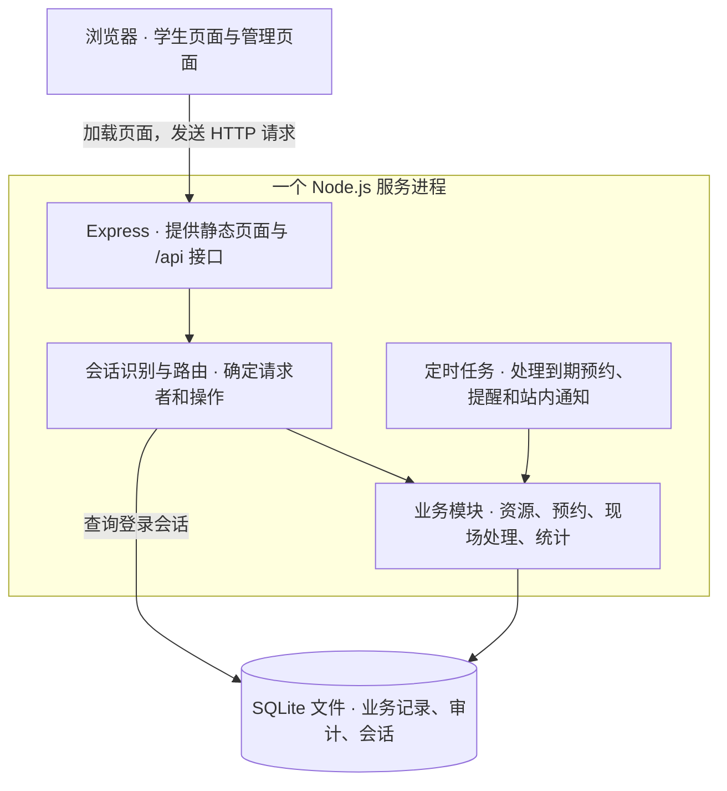
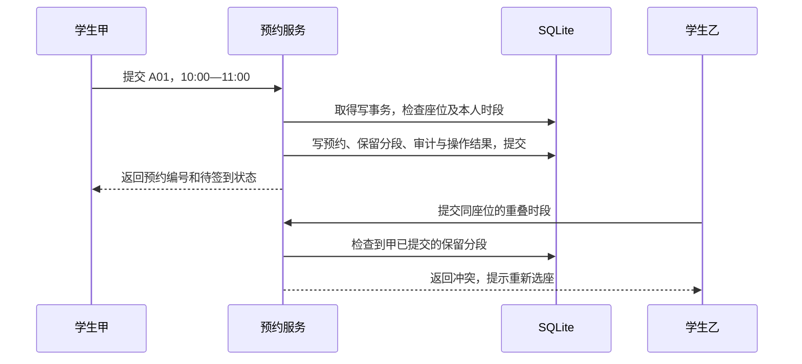

# 智慧自习室预约与管理系统架构设计报告

## 一、系统服务谁，管理什么

学生想预约明天上午的自习座位，需要知道自习室几点开放、哪些座位有正常插座，以及自己还能预约多久。预约成功后，系统为学生保留选定时段。学生到场扫描桌面二维码，系统才开始登记使用时间。**座位已被预约和座位已被使用，是系统分别记录的两件事。** 这个区别决定了其他人能否订座，也决定了管理员看到的使用率。

学生可以取消预约、暂离、签退，遇到占座或设施故障时可以报告问题并选择替代座位。场地管理员负责获授权场地的排班、设施、现场处置和报表。系统管理员维护账号、业务授权和规则版本。现场是否已经清空、占座报告是否属实，均由人员核实；系统保存核实结果并据此处理预约。桌面二维码能识别场地和座位，持续在座情况不在系统的观测范围内。

## 二、总体架构与部署

系统采用**浏览器访问的模块化单体架构**。学生端和管理端共用一个网站。浏览器负责交互，Node.js 服务负责业务判断，SQLite 文件保存记录。页面、业务接口和后台定时任务随同一个应用部署。预约、换座和停用会修改多种相关记录，把这些模块放在同一服务、同一数据库中，可以用一次本地事务保证这些修改一起成功或一起撤销。

| 部分 | 职责与实现位置 |
|---|---|
| 浏览器 | 原生 JavaScript 单页应用按角色显示菜单，按网址中的页面标识切换视图。选座图、路线、扫码和统计图表在浏览器中显示。页面通过统一请求模块访问同源接口。入口在 `public/js/app.js`，各业务页面位于 `public/js/views/`。 |
| HTTP 入口 | Express 从 `public/` 提供页面，在 `/api` 下接收 JSON 请求。服务从会话识别用户，在路由和具体业务操作中检查角色、对象归属或场地权限，并将业务错误转为相应的 HTTP 响应。入口在 `server/index.js`、`server/auth.js` 和 `server/routes.js`。 |
| 业务与持久化 | 预约、停用等模块通过 `server/db.js` 执行参数化 SQL 和事务。SQLite 启用外键和预写日志（WAL）。应用的定时任务与页面请求调用同一套预约到期处理逻辑。 |

交付环境要求 Node.js 22.5 或以上、pnpm 9 或以上。在项目根目录运行 `pnpm install --frozen-lockfile` 和 `pnpm start` 即可启动。默认访问地址为 `http://127.0.0.1:3000`，数据库默认位于 `data/studyroom.db`，首次启动时按需初始化演示数据。前端源码由服务直接提供，无需单独构建。此部署使用单个服务进程和本地数据库文件，数据库写事务串行执行。

## 三、业务模块怎样协作

| 模块 | 负责的业务 | 与其他模块的交接 |
|---|---|---|
| 场地、设施与选座 | 按场地和日期维护开放计划，管理座位、插座、停用时段及平面图。选座先检查开放、占用和必要设施，再按靠窗或入口距离排序。 | 查询结果提供候选座位和查询时间。学生提交时，预约模块重新检查当时的资源状态。路线计算把入口、通道和座位接入地图上的通行网络，用 Dijkstra 算法按通道距离计算从所选入口到座位的最短路径。 |
| 预约与到场登记 | 管理创建、取消、签到、暂离、返回、签退和换座。 | 从场地模块取得开放计划与设施条件，按学生名下的预约计算额度。用同一预约编号关联签到、座位变更、占用时段和实际使用时段。 |
| 现场问题与停用 | 学生报告后，管理员可以受理、答复并保留处理过程。座位需要检修时，管理员先预览受影响的预约，再确认停用。 | 占座报告受理后可影响签到截止时间。停用则依据座位和相交时段处置预约，换座后仍可继续处理原座位的问题。 |
| 违约、限制与反馈 | 记录自动爽约或手动登记的现场事件，支持复核、撤销、故障纠正、投诉和评价。 | 待复核事件经复核生效后才可作为预约限制的依据。依据撤销后重新检查关联限制，创建新预约时检查当前生效的限制。 |
| 统计、审计与通知 | 统计模块根据资源和使用记录计算指标；审计保存操作经过，通知向相关用户呈现结果。 | 创建预约等关键操作在业务事务中写审计，并按通知偏好登记待发送记录。后台任务另行处理投递，投递失败可重试，已经成功的预约继续有效。 |

## 四、数据设计：一笔预约为什么有三类时间记录

假设学生预约二层 A01，时段为 10:00—12:00，10:05 签到，11:00 换到 A04，11:30 签退。系统需要同时回答三个问题：这是谁的预约，其他人从什么时候可以订回 A01，两张座位各登记使用了多少分钟。

| 记录 | 该例中保存的内容 | 用途 |
|---|---|---|
| 预约主记录 `reservations` | 学生、场地、原定起止时间、当前座位、状态、首次签到时刻和规则版本。换座后当前座位为 A04，预约编号沿用原值。 | 查询“我的预约”，判断当前可执行的操作。 |
| 座位保留分段 `reservation_segments` | A01 保留 10:00—11:00，A04 保留 11:00—11:30。 | 选座和停用预览据此检查哪个座位在哪段时间被占用。 |
| 登记使用分段 `usage_segments` | A01 实际登记 10:05—11:00，共 55 分钟；A04 登记 11:00—11:30，共 30 分钟。 | 统计登记使用时间。暂离时结束当前使用段，返回后开新段；合法暂离期间座位仍为本人保留。 |

一个场地有多个座位，并按日期保存开放计划。一名学生可有多笔预约，每笔预约关联一个规则版本、至多一条签到记录，以及随换座、暂离产生的多条时间分段。换座明细另记原座、目标座与切换时刻。座位归档和恢复也保留生效历史，供统计还原当时可用的座位数量。

### 每日预约额度怎样计算

额度按预约的使用日期归属。系统初始规则为每人每天最多预约 4 次、累计 240 分钟。具备规则维护权限的管理员可以调整上限，新预约采用提交时已生效的规则版本。

创建预约时先计入整段预约时长。学生在开始前取消，系统全额返还分钟数，仍计 1 次预约。提前签退时，系统按首次签到至签退的时长结算；缺少首次签到记录时，取预约开始时间作为起点。上例中，学生 10:05 签到、11:30 签退，当天用去 85 分钟和 1 次预约。因场地停用而免罚取消或关闭的预约，次数和分钟数均返还。

## 五、关键业务流程与一致性

### 5.1 多人同时订座

座位图展示查询时的可用情况。两人可能同时看到 A01 空闲，因此最终分配发生在提交环节。服务开始 SQLite 写事务后，检查开放计划、停用、必要设施、本人额度和时段冲突。时段包含开始、不包含结束，所以 10:00—11:00 与 11:00—12:00 可以连续订出，10:00—11:00 与 10:30—11:30 则会冲突。

最外层写事务使用 `BEGIN IMMEDIATE`，嵌套业务操作使用保存点。这样，先完成提交的预约对下一笔写事务可见。网络超时时还需解决另一个问题：甲可能已订成功，却没有收到响应。创建预约要求携带操作键 `Idempotency-Key`；同一用户用相同键重发相同操作和内容，服务返回首次结果。同键改用不同内容会收到冲突响应。操作结果与预约一并提交，重试不会多占一次额度。

### 5.2 签到、占座与换座

学生扫描桌码后，服务核对当前用户、预约状态、签到窗口和座位码。静态桌码包含场地、座号和签名。普通预约的签到截止取“预约开始后 15 分钟”和“预约结束”两者中较早者（15 分钟为初始宽限设置）。到截止仍待签到，预约转为已爽约，释放座位并生成待复核事件。后台默认每 5 秒处理到期记录，预约接口也会在处理请求时补办已到期的状态转换。

若学生 10:02 报告座位被占，管理员 10:05 受理，服务检查学生是否仍在报告座位待签到、原截止是否未到，以及这笔预约是否已经获得过保护。保护截止取受理后 30 分钟与预约结束的较早者，只有能延长原窗口时才写入。对原本 10:15 截止、12:00 结束的预约，学生可以在 10:35 前签到或换座。保护期满仍未签到则免罚释放。若核实报告不属实且已过原截止，仍未签到的预约按爽约进入待复核；此前已经释放的座位不会重新占用。

换座页面提交目标座位和预约版本。服务核对归属、状态、同场馆剩余时段、冲突和必要设施；提交携带版本时还会检查版本是否匹配。原预约要求正常插座时，目标座位也须满足该条件。确认成功后，同一事务结束旧座保留段、建立新段、更新当前座位，并写入换座记录。学生已签到的，同时切分使用记录。目标失效或写入失败时，换座事务回滚，学生保留原预约。

### 5.3 场地排班与紧急停用

管理员按月查询开放计划；学生按使用日期查询。未发布计划的日期不能订座。管理页面切换场地时，桌面二维码、现场预约和评价应随当前场地加载，避免把二层的记录显示在三层名下。

检修一个座位分两步。管理员先选座位、停用时间并填写原因，服务返回受影响的预约清单和标识本次预览的摘要。确认时，服务在事务内重算影响范围。清单变化则要求重新预览；立即停用涉及使用中或暂离中的学生，还须确认现场已清空。成功时一并保存停用记录、受影响预约和审计。待签到预约免罚取消，正在使用或暂离的预约免罚关闭。

## 六、对外接口与访问控制

浏览器使用同源 HTTP 接口。登录后，浏览器携带会话 Cookie，服务据此查找用户及其授权。密码采用带盐的 scrypt 摘要，会话令牌以摘要形式保存在数据库中。业务操作使用服务端识别出的身份。例如签到时以登录学生和预约归属核对本人，统计查询按管理角色及可查看的场地确定范围。

| 操作 | 接口 | 输入与结果 |
|---|---|---|
| 查询座位 | `GET /api/availability` | 传场地、日期、起止时间，可加插座要求与入口偏好。返回开放计划、座位状态、候选和个人剩余额度。 |
| 确认预约 | `POST /api/reservations` | 提交座位、场地、时段和必要条件，携带操作键。成功返回 201、预约编号、规则版本及额度。 |
| 到座签到 | `POST /api/reservations/:id/checkin` | `:id` 为预约编号，请求中携带桌码。通过校验后记首次签到并开始登记使用。 |
| 确认换座 | `POST /api/reservations/:id/swap` | 提交目标座位和操作键。页面携带的预约版本用于发现其间发生的变更。 |
| 停用座位 | `POST /api/admin/suspensions/preview`、`POST /api/admin/suspensions` | 先取得影响清单，再带预览摘要及所需的清场确认提交。 |
| 查询统计 | `GET /api/admin/stats` | 按场地、日期和可选时段返回指标、各场馆对比和七日趋势。 |

服务将业务拒绝和内部故障分开返回。例如，争用同一座位返回 409，超出当天额度返回 422；页面可以分别引导学生重新选座或调整时长。异常响应包含错误代码和说明，浏览器据此显示处理结果。

## 七、管理报表如何复算

管理员选择二层 10:00—11:00 时，系统逐座计算该小时内已开放、已投入使用的分钟，扣除重叠停用区间的并集，得到**可用座位分钟**。再将各预约的登记使用段裁剪至相同窗口，求和得到**登记使用分钟**。查询当天时，两项都只算到本次统计时刻。

若 16 个座位均开放一小时，其中一个座位登记使用满 60 分钟，可用时间为 960 座位分钟，使用率为 60 ÷ 960 × 100% = 6.25%，页面显示 **6.3%**。主卡和场馆对比柱图取同一查询窗口和计算时刻；七日趋势按各日汇总。次日归档一个座位，昨日的分母仍按昨日生效的座位计算。分母为零时，使用率显示“—”。

预约创建量有独立的时间依据。若当天有开放计划，学生 07:30 成功预约明日座位，管理员查询今天 07:00—08:00 的创建量时，该笔计入今天，尽管场馆当时尚未开门。管理页面可见时按 10 秒周期刷新统计，切换条件后用请求序号丢弃迟到的旧结果。

## 八、质量目标与验证依据

| 质量要求 | 对应设计 | 项目中的验证依据 |
|---|---|---|
| 避免重复占座或重复提交 | 在写事务内检查时段冲突，按操作键保存首次结果。 | 预约测试覆盖重叠、相邻、重复提交等情形；换座测试检查旧座释放及新座预约保留。 |
| 防止现场处置误伤有效预约 | 换座更新保留分段，停用确认时重算影响清单，占座保护记录关联到原预约。 | 停用、占座和场地管理浏览器用例覆盖清场确认、保护到期、切换楼层等路径。 |
| 报表口径可复算 | 使用分段、座位生效历史和停用区间共同决定使用率；创建量按事件时刻归属。 | 统计用例分别检查卡片和图表、开馆前创建预约，以及归档或新增座位后重查历史报表。 |
| 查询和提交及时响应 | 对座位保留分段、用户预约和到期状态建立索引；页面按场地、日期或月份取数。 | 需求验收目标为 500 座、1 万条历史预约、20 并发条件下，95% 的查询在 2 秒内完成，95% 的预约提交在 3 秒内完成。项目提供性能样本生成命令，实际时延须以相应负载下的测量为准。 |
