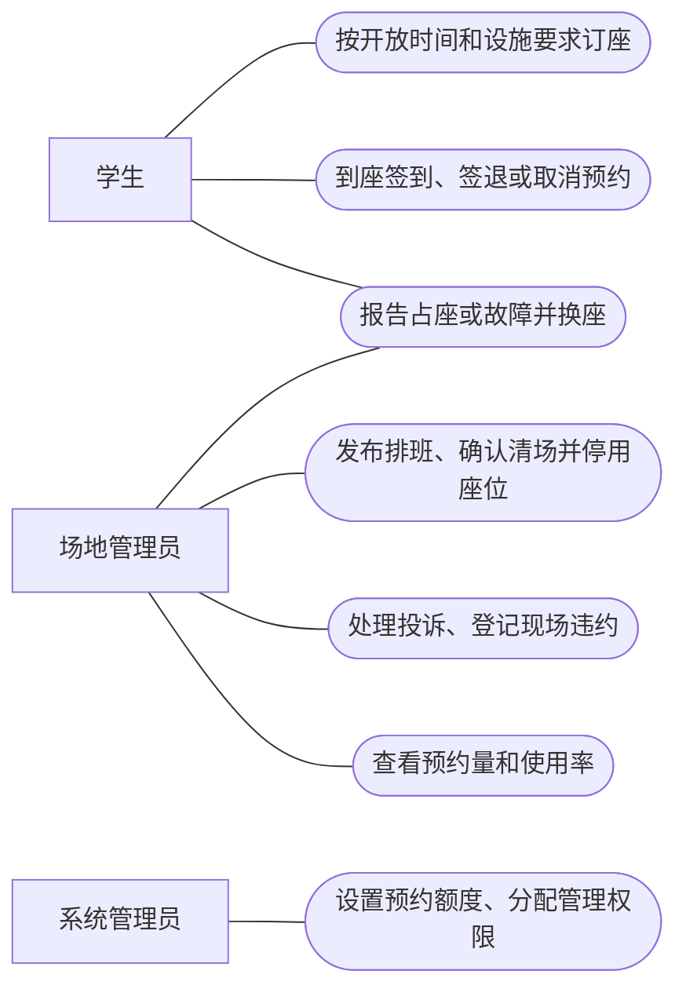

# 智慧自习室预约与管理系统软件测试报告

第 1 组　｜　测试日期：2026 年 11 月 26 日　｜　系统版本：1.0.0　｜　需求规格：V2.5.6

## 一、测试对象与目的

学生在系统中选择自习室、座位和使用时段，预约成功后到座扫码签到。如果座位被占或设施损坏，学生可以报告现场问题并申请换座。场地管理员负责发布每天的开放时间、处理现场事件和停用检修座位，也可以查看预约量与座位使用率。

本次测试沿这条业务流程检查三个问题：学生实际获得的座位和时段是否与预约一致，管理员能否通过页面完成现场操作，统计结果能否从预约和使用记录中复算。多人同时订座时，还检查同一座位在重叠时段内是否只分配给一人。本报告记录修复前版本的表现。

## 二、测试条件与判定方法

| 项目 | 本次使用条件 |
|---|---|
| 软件环境 | Windows，Node.js 24.22.3，Express 5.3.0，SQLite 3.54.1。已有用例通过 Vitest 5.1.0 执行，页面操作使用 Playwright Core 1.65.0。 |
| 场地和账号 | 图书馆二层 16 个座位、三层 8 个座位；使用合成学生、场地管理员和系统管理员账号。抢座测试使用 20 个分别登录的学生账号。 |
| 数据隔离 | 本机单服务进程，每组专项场景单独建立临时数据库。测试时钟按北京时间推进，以便在同一场景中观察开馆、签到截止和跨日后的状态。 |
| 测试依据 | 按《需求规格说明书》V2.5.6 判断座位是否可订、预约能否换座、额度如何扣除及统计应计入哪个时段。测试时使用的 64 个项目文件均与[版本校验清单](测试结果/测试版本文件校验清单.json)一致。 |

一次预约成功，既要能在学生页面查到，还要在数据库中占用正确的座位和时段。涉及报表时，由测试数据独立计算预期值。例如，16 个座位开放 1 小时，可用时间合计 960 座位分钟；其中 1 人使用满 60 分钟，使用率按一位小数显示为 6.3%。预约创建量则按学生提交成功的时间统计，即使预约的是次日座位，也应计入创建当天。

### 业务用例图



## 三、测试执行与结果

| 轮次 | 检查内容 | 实际结果 |
|---|---|---|
| 第一轮：基本流程和业务验收 | 先运行已有用例，再从学生、管理员两端检查开放计划、换座、历史报表与设施变更。 | 已有用例 50 项通过，另有 1 项环境占位用例跳过；5 项真实浏览器用例全部执行。新增业务检查 14 项，8 项通过、6 项失败，涉及排班查询、旧座释放和两类统计错误。[已有用例结果](测试结果/01-第一轮/第一轮原有回归结果.json) · [业务验收结果](测试结果/01-第一轮/第一轮业务验收结果.json) |
| 第二轮：规则与并发 | 从预约一直操作到换座、取消或签退；比较正常与调整后的额度，并让多个账号同时操作。 | 16 项检查中 14 项符合当时的预期，2 项失败，均与换座丢失插座要求有关。并发检查全部通过。同座抢订的 250 批请求中，未出现重叠时段重复占座。[业务与并发结果](测试结果/02-第二轮/第二轮业务与并发结果.json) |
| 第三轮：复测组员发现 | 从组员审查报告中选取 14 项，分别通过页面、接口或数据库核对。 | 共 22 个检查点，21 项与预期不符，1 项对照符合预期。同一问题可设多个检查点，例如比较逾期签到在有无积压时的处理结果。[第三轮结果](测试结果/03-第三轮/第三轮组员问题复测结果.json) |
| 第四轮：重跑与补查 | 在同一修复前版本上重跑第三轮，再补查其余 13 项，覆盖组员报告的全部 27 项。 | 重跑的 22 个检查点结果一致。补查分别保留直接操作、代码核对和离线模拟的证据；另外执行的 5 项浏览器用例均通过，1 项环境占位用例跳过。[业务重跑](测试结果/04-第四轮/第四轮业务重跑结果.json) · [补查记录](测试结果/04-第四轮/第四轮补测结果.json) · [浏览器回归](测试结果/04-第四轮/第四轮浏览器回归结果.json) |

## 四、业务问题、整改分工与验收条件

小组合并了各轮重复发现的问题，选定 12 项整改。以下按四名成员负责的业务范围，列出学生或管理员遇到的情况，以及修复后应达到的结果。

### 成员一（金施成）　换座与占座处理

**1．学生已换到新座，停用旧座仍会取消这笔预约。** 学生在预约开始前从 A01 换到 A04，预约编号不变，另一名学生却仍订不了同一时段的 A01。管理员只停用 A01 后，A04 上的预约也被取消。复测时应同时满足两项条件：其他学生能订回已释放的 A01，单独检修 A01 不影响 A04 的预约。

**2．换座时丢失了学生原先勾选的插座要求。** 学生订 A01 时勾选“必须插座正常”，报告座椅故障后，换座页自动取消勾选。插座故障的 A06、A11 均进入候选，学生实际换到 A06 成功。复测从首次订座开始；只要学生没有主动放宽条件，候选列表和最终换座都应满足原要求。

**3．学生已报告占座，等待处理期间仍会失去预约。** 学生 10:02 报告占座，管理员 10:05 受理，此时还有 15 个替代座位。到 10:16，报告仍在处理中，预约却已转为爽约，原预约也不能再换座。此项涉及业务规则：受理报告和核实学生已到场是两个环节。复测须按小组确认的到场核实条件、保留时限和超时处置，分别核对预约状态、换座资格及待复核记录。

### 成员二（俞烨涛）　排班与场地管理

**4．排班超过 60 条，管理员查不到最新计划。** 连续发布两段各 31 天的计划后，学生能查到 2027 年 2 月 3 日 08:00—22:00 的开放安排，管理列表却只显示最早的 60 条，止于 1 月 17 日。复测时保留超过 60 条计划，按目标日期查询，核对管理员和学生看到的开放时间是否一致。

**5．座位已经清场，管理员仍不能确认停用。** 学生签到后，管理员为 A01 填写检修原因并预览停用影响。点击“现场已清空”，勾选随即消失，“确认停用”仍不可点，数据库新增停用记录 0 条。复测要从管理页面完成整套操作：未确认清场时不能提交，确认后应生成停用记录，并按场地原因免罚关闭受影响的预约。

**6．管理员切换楼层后，仍会看到上一楼层的记录。** 从二层切到三层，标题已经更新，评价列表里却仍有二层的专用测试标记；桌面二维码和现场预约一直提示加载，切走标签再回来才恢复。复测时在这三个标签内分别切换楼层，核对评价、二维码和预约均属于新选楼层。

### 成员三（钱瑾）　使用率与预约统计

**7．今天增减座位会改变昨天的使用率。** 昨日二层 16 座开放一小时，实际登记使用 60 分钟，报表显示 6.3%。次日归档一座后，重查昨天变成 6.7%；恢复后再新增一座，又变成 5.9%。复测时分别在归档、恢复、新增后查询昨日同一小时，昨日仍应有 960 个可用座位分钟，使用率为 6.3%。

**8．开馆前成功创建的预约被漏计。** 学生 07:30 成功预约次日座位，已取得预约编号；管理员 09:00 查询创建当天 07:00—08:00 的预约创建量，提交前后均为 0。复测时以预约编号和创建时间为准，该统计窗口内的创建量应增加 1。

**9．同一楼层、同一小时，卡片和柱状图给出不同使用率。** 查询二层 10:00—11:00，16 座中只有一座使用满一小时。卡片按这一小时计算，显示 6.3%；标注“同日同时段”的柱状图却用了全天的 13,440 个可用座位分钟，显示 0.4%。复测时两处均应按所选小时计算，结果都是 6.3%。

### 成员四（刘洁）　预约额度与违约记录

**10．学生提前取消或签退，仍占用整段预约额度。** 每日上限为 240 分钟时，学生提前一天取消四小时预约，座位已释放，本人剩余额度却为 0，无法在原预约日改订一小时。另一名学生只使用半小时便签退，仍按四小时扣除。把上限调至 840 分钟后，可以成功预约 08:00—22:00。此项需确定取消、提前签退分别应扣多少分钟；复测应同时核对扣除额、剩余额度和实际能否改订。

**11．没有预约编号的现场违约无法登记。** 需求允许管理员记录无预约编号的现场事件。管理员在“手动登记”选好学生、填写现场事实并提交，页面报错，数据库没有新增记录。登记只创建待复核事件，由有权限的人员核实后再认定违约。复测时应能从同一页面提交并查到一条待复核记录，学生、场地和事实说明均与录入内容一致。

**12．逾期签到提示已爽约，预约记录仍为待签到。** 一笔预约 10:15 截止，学生 10:16 用正确桌码签到，系统拒绝并提示已爽约；当即读库仍为待签到，待复核事件和审计记录各 0 条。没有其他预约积压时也能出现，再查询一次预约才补齐。复测要在签到响应返回时读库，分别覆盖有无积压和有无防重复提交标识，确认预约状态与提示一致且只生成一份记录。

## 五、测试结论

修复前版本能够完成基本预约和常见并发操作，但学生完成换座后仍可能丢失有效预约，场地管理员也有正常操作无法提交。统计报表的历史使用率、图表对比和预约创建量均出现可复算的偏差。

小组将上述 12 项纳入整改，每人负责 3 项。占座等待期间如何保留预约、提前释放座位后如何计额，涉及两项业务规则调整；其余 10 项按功能实现问题处理。其他发现及证据范围见附录 B。本报告的判定截止于修复前四轮测试，修复版本的关闭依据为对应场景的复测记录。


## 附录 A　业务用例与执行明细

### 第一轮已有回归用例明细

8 个测试文件中有 50 项用例通过。浏览器文件另有一个仅在缺少本机浏览器时启用的占位用例，本次跳过。下表列出实际执行的场景。

| 测试范围 | 通过数 | 主要判定 |
|---|---:|---|
| 学生与管理端浏览器操作 | 5 | 学生能预约并查看路线；学生页、两类管理页可加载，390 像素宽度下无横向溢出。 |
| 前端组件与显示 | 7 | 文本转义、时长与百分比、查询参数、北京时间、座位可用状态、路线和图表显示符合预期。 |
| 日期与区间工具 | 4 | 日期解析、北京时间换算、相邻与重叠时段的判断、重叠分钟合并均正确。 |
| 预约创建与冲突 | 7 | 必要条件筛选、预约编号、重复提交、同座和同人时段冲突、取消释放、每日额度。 |
| 签到、暂离与签退 | 9 | 提早或扫码错误被拒，正常签到与重试、暂离返回、签退释放、截止时刻、故障纠正和取消时限符合用例预期。 |
| 座位停用与恢复 | 6 | 接口验证清场确认、未来停用冲突、免罚取消、场地权限、预览失效和停用期间禁订。 |
| 投诉、违约与限制 | 8 | 登记去重、复核生效、限制解除、投诉关闭、评价隐藏、通知权限与重试、授权场地查询。 |
| 统计计算与权限 | 4 | 样例使用率 42.9%，无开放计划时显示“—”，系统管理员及场地管理员的统计权限按用例判定。 |

逐条用例名称与执行状态见[第一轮原有回归结果](测试结果/01-第一轮/第一轮原有回归结果.json)。已有的清场测试直接调用接口，专项测试则要求管理员在浏览器中完成勾选和提交，因此能发现页面按钮无法使用的问题。

### 第一轮：开放计划、换座、报表与设施

检查开放计划时，两间自习室的排班都只到 12 月 1 日，12 月 2 日尚未排班。因此先在临时库验证排班到期和补排后学生能否预约，再发布 62 天计划，对照学生和管理员能否查到最后一天。下表也列出同轮执行的换座、报表和设施检查，共 14 项。

| 用例 | 前置条件和操作 | 预期结果 | 实测 |
|---|---|---|---|
| P01-R1、P01-R2 | 将临时库的业务日期调至已有排班结束后的第一天，分别查询二层、三层 10:00—11:00。 | 没有计划的房间，所有座位显示关闭并给出原因。 | 均通过。二层 16 座、三层 8 座全部关闭，原因均为“当日无开放计划”。 |
| P02 | 管理员为二层补排 08:00—22:00，学生再次查询并预约 A01。 | A01 可用，提交后生成待签到预约。 | 通过。查询可用，预约进入待签到。 |
| P03 | 对已有 10:00—11:00 有效预约的日期，将开馆时间改为 12:00。 | 拒绝直接缩短，学生端仍显示原计划。 | 通过。返回 409，重新查询仍为 08:00—22:00。 |
| P04 | 连续再发布 62 天排班，推进到最后一天，分别查学生端和场地管理端。 | 两端都能找到当天已发布的计划。 | 失败。学生端能查到当天安排，管理列表止于更早的日期。 |
| S01 | 学生甲预约 A01 并报告插座问题，在开始前用当前版本确认换到同房间 A04。 | 保留预约编号和待签到状态，座位改为 A04。 | 通过。编号相同，A04 待签到。 |
| S02 | 完成 S01 后，学生乙查询 A01 并提交相同时段的预约。此时 A01 未被管理员停用，学生乙未要求插座。 | 旧座可预约，提交成功。 | 失败。A01 显示已占用，提交返回 409。 |
| S03 | 保持 A04 的预约，管理员仅预览并停用 A01 的 10:00—11:00，再读取甲的预约。 | 预览不包含甲的预约，A04 继续待签到。 | 失败。预览包含甲的预约，提交后 A04 已取消，原因为“场地停用”。 |
| H01 | 在二层 16 座开放的统计日，学生 10:00 签到、11:00 到期。次日回查前一天 10:00—11:00。 | 可用 960 座位分钟，登记使用 60 分钟，使用率 6.3%。 | 通过。三项与手算相同。 |
| H02 | 取得 H01 基线后，次日归档 A01，重查前一天相同时段。 | 可用 960 座位分钟，使用 60 分钟，使用率 6.3%。 | 失败。实际为 900、60、6.7%。 |
| H03 | 恢复 A01 并确认基线已恢复，再新增 Z99，重查前一天相同时段。 | 新座位从新增当天投入使用，可用 960 座位分钟，使用 60 分钟，使用率 6.3%。 | 失败。实际为 1020、60、5.9%。 |
| H04 | 07:30 成功预约次日座位，09:00 查当天 07:00—08:00 的创建量，对比提交前后的数值。 | 该时段的创建量增加 1。 | 失败。预约记录显示 07:30 创建，报表仍为 0。 |
| F01 | 乙查询有正常插座的座位。管理员在乙提交前将插座登记为故障，乙用原选座提交并重新查询。 | 提交被拒，刷新后该座不再符合插座条件。 | 通过。提交返回 422，刷新显示设施不符合要求。 |
| F02 | 管理员核实维修完成，恢复插座状态。乙再次按相同条件提交。 | 能正常预约。 | 通过。返回 201。 |

### 第二轮：额度、占座与并发

规则用例按当时生效的规定判定。提前取消仍扣整段额度、等待处理超过签到期限仍转爽约，均与当时规则相符，其业务后果已列入小组整改。

| 用例 | 操作与预期 | 实测 |
|---|---|---|
| R01、R04 | 比较默认 240 分钟与管理端发布 840 分钟规则后，08:00—22:00 能否整段预约。 | 默认拒绝。测试库调参后成功，新预约占用 840 分钟。 |
| R02 | 提前一天取消四小时预约，再查询旧座，并改订预约日的另一时段。按现行规则旧座释放、个人额度不返。 | 旧座可选，个人剩余 0 分钟，改订被拒。 |
| R03 | 四小时预约使用半小时后主动签退，再订当晚一小时。按现行规则仍按原定时长计额。 | 已用额度仍为 240 分钟，再订被拒。 |
| R05 | 签到截止前报告占座，管理员受理，等待超过截止时间，再查预约、问题、候选和违约记录。 | 预约已爽约，问题处理中，不能再换座，有一条待复核事件。 |
| U01、U02 | 以插座为必要条件预约，报告故障后在真实页面查看替代列表。预期默认继承原条件，不主动放宽时不能换到插座故障的座位。 | 两项均失败。原条件未勾选，两个故障座位入选，实际确认换至 A06。 |

为验证多人能否订到同一座位，20 个账号同时提交预约。下表五种时段组合各测 50 批，共 5,000 次请求。每批结束后，将成功返回的预约编号与数据库中的占用时段逐笔核对。本次在单服务进程和 SQLite 环境下检查预约记录的正确性。

| 同座并发用例（每批 20 个账号，每类 50 批） | 合格条件 | 实测 |
|---|---|---|
| 相同，09:00—10:00 | 仅一笔预约成功 | 50/50 批符合 |
| 部分重叠，10:00—11:00、10:30—11:30 | 两时段互斥 | 50/50 批符合 |
| 完全包含，12:00—13:30、12:30—13:00 | 两时段互斥 | 50/50 批符合 |
| 首尾相邻，14:00—15:00、15:00—16:00 | 两段可分别订出 | 50/50 批符合 |
| 链式重叠，17:00—18:00、17:30—18:30、18:00—19:00 | 中间段成功时保留一段；两端时段可共存 | 50/50 批符合，其中 17 批保留一段，33 批保留两段 |

| 其他并发用例 | 预期与实测 |
|---|---|
| 同一请求同时重发 20 次 | 20 次返回同一预约编号，库中仅 1 个占用分段、1 条创建审计、1 条创建通知。通过。 |
| 同人同时预约两个座位 | 一次成功、一次冲突，数据库只保留 1 笔同一时段有效预约。通过。 |
| 两人同时换至 A04 | 一人成功，另一人保留原座；变更记录中仅 1 笔换至 A04。通过。 |
| 争用剩余 30 分钟额度 | 已用 210 分钟，并发申请两个不重叠的 30 分钟时段。一笔成功、一笔因额度被拒，合计 240 分钟。通过。 |

## 附录 B　组员审查报告的 27 项复核

组员报告为每个发现分配了 F-01 至 F-27 的编号。下表按原编号排列，其中 7 项与正文整改事项对应。其余 20 项保留实际观察；仅做授权账号对照、代码核对或离线模拟的项目，分别注明验证范围。

| 检查对象 | 复核结果 |
|---|---|
| 逾期签到（F-01） | 按页面方式携带防重复提交标识时，即使没有积压，也出现“提示已爽约、库中待签到”。在先到期记录为 0 或 200 条，各比较有无标识两种情况；仅“0 条且不带标识”在应答时状态和两条关联记录均正确。观察时延长了后台轮询间隔。 |
| 预约开始前换座（F-02） | 另一名学生订旧座被拒。随后只停用 A01，已经换到 A04 的预约也被取消。 |
| 无预约编号的现场登记（F-03） | 管理员从页面提交一条无预约编号的现场事件，未保存待复核记录。 |
| 已清场座位停用（F-04） | 确认清场后勾选消失，按钮仍然禁用，新增停用记录 0 条。 |
| 场地停用列表可见范围（F-05） | 授权场地的停用查询正常。代码核对发现列表查询缺少操作者的场地范围检查，未动态验证跨场地读取。 |
| 选座参数校验（F-06） | 正常选座查询成功，页面拦截颠倒的起止时间。离线模拟参数绑定异常时，项目错误处理器返回 500；缺参接口未逐个动态复现。 |
| 业务复核记录的可见范围（F-07） | 已授权账号的违规、故障查询成功。代码核对发现部分系统管理员查询分支未统一核对业务授权，未用无授权账号读取记录。 |
| 重置密码后的登录会话（F-08） | 管理员重置合成账号密码后，未过期会话记录仍为 1 条。未使用旧会话访问。 |
| 同时段图表对比（F-09） | 卡片和柱状图在同一查询窗口分别显示 6.3% 和 0.4%，与接口返回的两个不同分母一致。 |
| 历史座位使用率（F-10） | 昨日使用记录未变，次日归档和新增座位后，历史使用率由 6.3% 分别变为 6.7% 和 5.9%。 |
| 普通报修的处理人回避（F-11） | 先选违约申诉再改成设施报修，已提交的普通报修仍带原违规编号，并将原处理人记作需回避人员。 |
| 普通投诉与现场问题列表（F-12） | 普通服务投诉关联本人预约后，现场问题列表包含该投诉，同一预约详情的现场问题中却没有。 |
| 跨楼层切换（F-13） | 在二维码、现场预约、评价三个标签内切换楼层，前两项持续加载，后一项保留原楼层数据。 |
| 管理员辅助签到（F-14） | 正常辅助签到成功，文字说明和辅助方式已保存；离线模拟存储绑定异常返回 500。非文本说明未向业务接口提交。 |
| 建立限制时的依据（F-15） | 一条生效违规可成功建立限制，库中依据为 1 条。前端以集合保存勾选；离线模拟存储约束错误返回 500。重复依据未向真实接口提交。 |
| 会话解析异常（F-16） | 正常匿名健康检查、正常会话查询均返回 200。解码异常在离线错误处理器中返回 500，未发送损坏的 Cookie。 |
| 投诉长度与请求上限（F-17） | 2,000 字投诉说明完整保存，返回 201。解析器上限为 256 KB，离线输入解析器的 413 错误后被映射为 500；未发送超大请求。 |
| 管理页面新增座位（F-18） | 场地管理页可归档座位，未找到新增入口。同一管理员通过服务新增 Z99，页面刷新后可见。 |
| 获授权管理员的复核入口（F-19） | 具备业务复核授权的系统管理员登录后可见投诉处理，导航中没有违约复核入口。 |
| 扫码失败后的重复识别（F-20） | 模拟相机持续识别同一标识，模拟首次校验失败。随后 1.3 秒内前端再提交 5 次，关窗后新增 0 次。请求被测试替身拦截。 |
| 投诉与预约的场地匹配（F-21） | 投诉场地选三层，仍可选本人二层的预约；提交时返回 422，错误关联未入库。历史列表重复显示时间由页面代码核对。 |
| 换账号后保留勾选（F-22） | 同一浏览器换账号后，“已阅读并同意预约规则”仍勾选，新账号选座后勾选清空。未验证个人记录泄露。 |
| 返回预约页的筛选时段（F-23） | 查询并保存 14:00—15:00，离开后重返预约页，时间恢复为 08:00—09:00。 |
| 管理员权限配置（F-24） | 新建场地管理员，两项权限在配置中均关闭。登录资料中统计权限为开启，复核标志为关闭；复核逻辑另按场地角色判断。 |
| 关闭演示模式后的签到入口（F-25） | 显式关闭演示模式后，学生扫码窗口仍显示“使用本人桌面码签到”。未点击该入口完成签到。本机登录 Cookie 有 HttpOnly、SameSite=Lax，未设 Secure。 |
| 原始系统交付包内容（F-26） | 清点可取得的交付 ZIP，共 64 个文件，无运行数据库、Git 指针、coverage 或 tests/practice；其中 58 个服务端、前端和测试文件与副本逐项相同。 |
| 已有浏览器用例的覆盖范围（F-27） | 项目原有 5 项浏览器用例均通过；专项仍复现手动登记、清场、切换场地三处错误。原覆盖率配置只纳入 6 个工具模块。 |


## 附录 C　测试脚本与复跑方法

| 轮次 | 执行入口 | 输出 |
|---|---|---|
| 第一轮 | 项目已有回归命令（见下文）、[第一轮业务验收脚本](测试脚本/第一轮业务验收.mjs) | 第一轮原有回归结果、第一轮业务验收结果 |
| 第二轮 | [第二轮业务与并发脚本](测试脚本/第二轮业务与并发.mjs) | 第二轮业务与并发结果，含每批请求与占用记录 |
| 第三轮 | [第三轮组员报告复测脚本](测试脚本/第三轮组员报告复测.mjs) | 第三轮组员问题复测结果 |
| 第四轮 | [第四轮全项复核脚本](测试脚本/第四轮全项复核.mjs) | 第四轮业务重跑结果、第四轮补测结果、第四轮浏览器回归结果 |

**准备测试版本。** 在报告目录以外解压原始系统 1.0.0，使用含 `package.json` 的项目根目录。第四轮还要清点当时交付的系统 ZIP，该文件的 SHA-256 为 `25ef6f15153948eecb347ee7f3a6aa8af928cadeba557220f415e5051af8a829`。该 ZIP 与测试版本的 64 个文件中有 63 个逐字节一致，唯一差异为 README.md。复跑脚本识别这两个已知的说明文件版本，其他差异会终止基线校验。测试依赖为 Node.js 24、pnpm 10、本机 Chrome 或 Edge；交付包清点另用 Python 3.11 或更高版本。

在报告所在目录打开 PowerShell，指定外部项目和原始系统 ZIP。复跑结果写入本机临时目录，与报告中的原始记录分开保存。

```powershell
$env:TEST_PROJECT = (Resolve-Path -LiteralPath (Read-Host '测试项目根目录')).Path
$env:DELIVERY_ZIP = (Resolve-Path -LiteralPath (Read-Host '原始系统 ZIP 路径')).Path
$env:TEST_OUTPUT = Join-Path ([IO.Path]::GetTempPath()) ('自习室测试-' + [guid]::NewGuid())
New-Item -ItemType Directory -Path $env:TEST_OUTPUT | Out-Null
Push-Location -LiteralPath $env:TEST_PROJECT
pnpm install --frozen-lockfile
Pop-Location
```

**第一轮已有用例。** 指定当时执行的 8 个测试文件所覆盖的范围，以复核 50 项通过、1 项跳过的记录。

```powershell
Push-Location -LiteralPath $env:TEST_PROJECT
$cases = @(
  'tests/unit/server/time.spec.js', 'tests/unit/server/stats.spec.js',
  'tests/unit/server/reservation.spec.js', 'tests/unit/server/suspension.spec.js',
  'tests/unit/server/lifecycle.spec.js', 'tests/unit/server/governance.spec.js',
  'tests/unit/client', 'tests/e2e'
)
node --no-warnings node_modules/vitest/vitest.mjs run @cases --reporter=json "--outputFile=$env:TEST_OUTPUT/第一轮原有回归结果.json"
Pop-Location
```

**四轮专项脚本。** 第三、四轮会对测试项目核对 64 个文件的校验值。如需同原项目目录一并核对，可将 `ORIGINAL_PROJECT` 设为该目录的完整路径。第四轮清点 ZIP 时也使用该变量对照目录内容；新解压的项目与当时已运行过的桌面目录在数据库文件上可能有差别。

```powershell
node --no-warnings ./测试脚本/第一轮业务验收.mjs
node --no-warnings ./测试脚本/第二轮业务与并发.mjs
node --no-warnings ./测试脚本/第三轮组员报告复测.mjs
node --no-warnings ./测试脚本/第四轮全项复核.mjs
Get-ChildItem -LiteralPath $env:TEST_OUTPUT
```

第一、二轮在业务结果不符合预期时返回退出码 1，并保存逐项结果。第三、四轮按观察结果记录，需查看 JSON 中的预期值、实际值和核查方式。若出现服务启动失败、`test_error` 或 `setupError`，该项属于执行异常，须排除环境问题后再判定。
